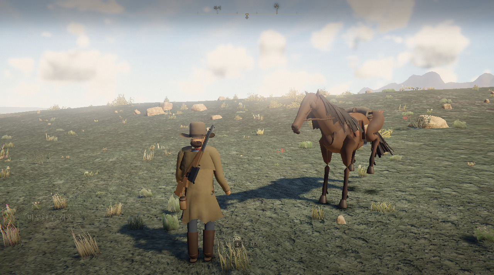
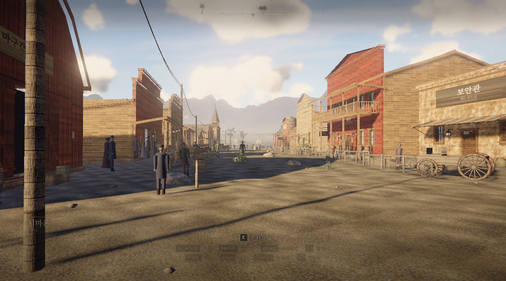
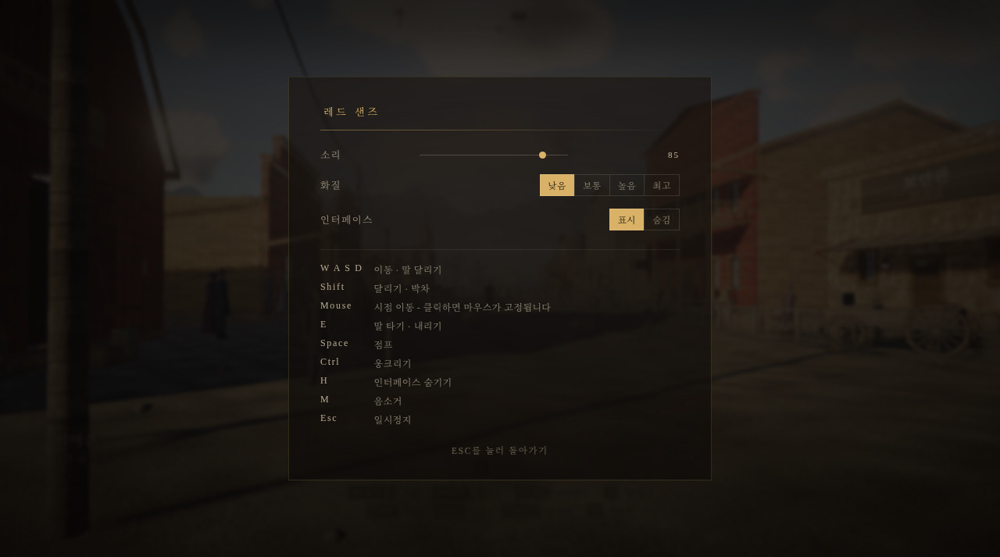

<div align="center">


# 레드 샌즈 (RED SANDS) 한국어판

**브라우저 탭 하나에서 돌아가는 오픈월드 서부극**

8 km² 규모의 침식 지형 · 물리 기반 하늘 · 체적 날씨 · 말, 사냥, 그리고 마을
설치도, 플러그인도, 아트 파일도 없습니다. 모든 텍스처, 메시, 사운드가 실행 중에 생성됩니다.

[](https://sigco3111.github.io/red-sands/)
[](https://threejs.org)
[](https://developer.mozilla.org/docs/Web/API/WebGL2RenderingContext)
[](LICENSE)

**[바로 플레이하기 &rarr; https://sigco3111.github.io/red-sands/](https://sigco3111.github.io/red-sands/)**

</div>

---

> 이 저장소는 [gillworks/red-sands](https://github.com/gillworks/red-sands) (MIT)의 **한국어 번역 포크**입니다.
> 원작자와 저작권 표기는 그대로 유지했고, 원본 README는 [`README.en.md`](README.en.md)로 보존했습니다.
> 게임 로직과 데이터 ID는 건드리지 않고 화면에 보이는 글자만 한국어로 옮겼습니다.

## 한글화 내용

| 구분 | 번역 내용 |
|---|---|
| 로딩 화면 | 제목, 부제, 20단계 로딩 문구 (예: "대지를 일으키는 중", "안장을 얹는 중") |
| HUD | 조작 힌트(이동, 달리기, 웅크리기, 조준, 발사, 재장전 등), 상호작용 안내(말 타기, 내리기, 물 마시기, 불 쬐기, 가죽 벗기기), 나침반 방위(북·북동·동…) |
| 지역 타이틀 카드 | 지역 이름(예: "미루나무 개울", "방울뱀 협곡")과 시각 문구("아침 여섯 시 반쯤") |
| 수배 시스템 | 알림 문구("누군가 당신을 봤다", "보안관이 당신을 쫓고 있다" 등) |
| 사냥 | 동물 이름, 명중 부위, 가죽 벗기기 진행 문구 |
| 일시정지 메뉴(ESC) | 소리, 화질(낮음/보통/높음/최고), 인터페이스 표시, 조작 키 안내 |
| 마을 간판과 벽보 | 잡화점, 술집, 은행, 호텔, 보안관, 대장간 등 12개 간판과 현상수배 포스터 등 4종 벽보 (런타임 캔버스에 한글로 직접 그림) |
| 글꼴 | Noto Serif KR을 Google Fonts에서 불러오고, 실패하면 시스템 한글 글꼴로 대체 |
| 페이지 정보 | `lang="ko"`, 제목, 설명, Open Graph 메타 |

번역 로직은 [`src/i18n.js`](src/i18n.js) 한 곳에 모아 두었습니다. HUD가 글자를 그리기 직전에 사전과 패턴으로 번역하는 방식이라 원본 코드 변경을 최소화했습니다. 한글은 자간을 넓히면 어색해서 한글 문자열은 자간을 자동으로 줄입니다.

## 스크린샷

| 실행 직후 (HUD: 방위, 지역 이름, 말 타기 안내) | 마을 거리 (한글 간판) |
|---|---|
|  |  |



위 화면은 GitHub Pages 배포본을 실제로 실행해 찍은 캡처입니다 (낮은 화질 설정, 소프트웨어 렌더링).

## 조작법

| 키 | 동작 |
|---|---|
| **W A S D** | 이동 |
| **Shift** | 달리기 / 질주 (말 위에서는 박차) |
| **Ctrl** | 웅크리기 (조용해져서 동물이 잘 눈치채지 못함) |
| **E** | 말 타기 / 내리기 · 사냥감 가죽 벗기기 |
| **마우스 오른쪽** | 소총 들기(조준) |
| **Shift** *(조준 중)* | 숨 참기로 조준 안정 |
| **마우스 왼쪽** | 발사 |
| **R** | 재장전 |
| **F** | 물가에서 물 마시기 |
| **H** | 인터페이스 숨기기 |
| **M** | 음소거 |
| **ESC** | 일시정지 / 설정 |

화면을 한 번 클릭하면 마우스가 고정됩니다. 키보드와 마우스가 있는 PC 환경을 기준으로 만든 게임이라 모바일 터치는 지원하지 않습니다.

## 실행 환경과 팁

- WebGL2를 지원하는 최신 데스크톱 브라우저 (Chrome, Edge, Firefox, Safari)
- 그래픽 카드가 있는 PC를 권장합니다. 처음 로딩 때 재질을 굽는 데 수 초가 걸립니다.
- 느리면 주소 뒤에 `?quality=low` 또는 `?quality=medium`을 붙이거나 ESC 메뉴에서 화질을 낮추세요. 화질을 바꾸면 페이지가 다시 로드됩니다.
- 한글 글꼴은 인터넷에서 내려받습니다. 오프라인이면 시스템 한글 글꼴로 표시됩니다.

## 로컬 실행

```bash
npm install
npm run dev      # http://localhost:5173
npm run build    # dist/ 생성
```

GitHub Pages 배포용 빌드는 저장소 이름을 기준 경로로 지정합니다.

```bash
npx vite build --base=/red-sands/
```

이 포크는 `.github/workflows/pages.yml` 워크플로로 빌드와 배포를 자동화합니다.

## 기술 요약 (원작 소개 번역)

- **하늘과 빛**: Hillaire 방식의 대기 산란(투과율, 다중 산란, 하늘 뷰 LUT), 레일리 + 미 산란, 오존 흡수층. 태양은 NOAA 천문 계산을 따르고, 밤하늘에는 6,600개의 별과 은하수가 회전합니다.
- **지형**: 도메인 워핑 릿지드 멀티프랙탈 위에 실제 **수력 침식** 시뮬레이션을 돌려 수지상 배수망과 선상지를 만듭니다. 흐름 누적 지도가 강, 식생 밀도, 잔해 분포를 결정합니다.
- **렌더링**: 캐스케이드 그림자 맵(PCSS), GTAO, TAA, SSR, 레이마칭 체적 구름, AgX 톤매핑.
- **재질**: 부팅 시 워커 풀에서 35종의 절차적 PBR 표면을 굽습니다.
- **생명**: 동물은 시각, 청각, 냄새로 사람을 감지합니다. 바람 부는 쪽에 서면 사슴 떼가 알아채지 못합니다. 말은 네 가지 걸음걸이를 갖고 있습니다.
- **오디오**: 샘플 없이 WebAudio로 전부 합성합니다. 총성의 메아리는 실제 지형을 탐색해 반사 시간을 계산합니다.

## 구조

```
src/core/       Engine, Context(공유 계약), Config
src/materials/  절차적 PBR 라이브러리 + 워커 베이크 풀
src/world/      Terrain · Vegetation · Scatter · Town
src/render/     Sky · Clouds · Water · Lighting · Particles · PostFX
src/sim/        TimeOfDay · Weather · Physics · Wildlife
src/player/     Player · Horse · Weapon · CameraRig
src/audio/      합성 사운드와 효과음
src/ui/         HUD, 일시정지 메뉴, 지역 이름, 수배 시스템
src/i18n.js     (추가) 한국어 번역 사전과 패턴
```

## 알려진 한계

- 캔버스에 구워진 마을 간판은 한 번만 그려지므로, 한글 글꼴이 4초 안에 로드되지 않으면 시스템 글꼴로 그려집니다.
- 지역 이름은 원작처럼 단어 조합으로 무작위 생성되며, 한국어 조합은 어색한 이름이 나올 수 있습니다.
- 원작의 개발 도구(`tools/`)와 문서(`docs/`)는 번역하지 않았습니다.

## 라이선스와 출처

- 원작: [gillworks/red-sands](https://github.com/gillworks/red-sands), MIT 라이선스 (`LICENSE` 유지)
- 한국어 번역: sigco3111
- 원작 README의 설명대로 이 프로젝트는 Rockstar Games와 관련이 없습니다.
